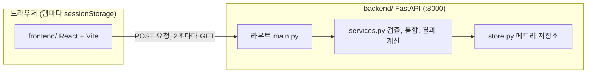
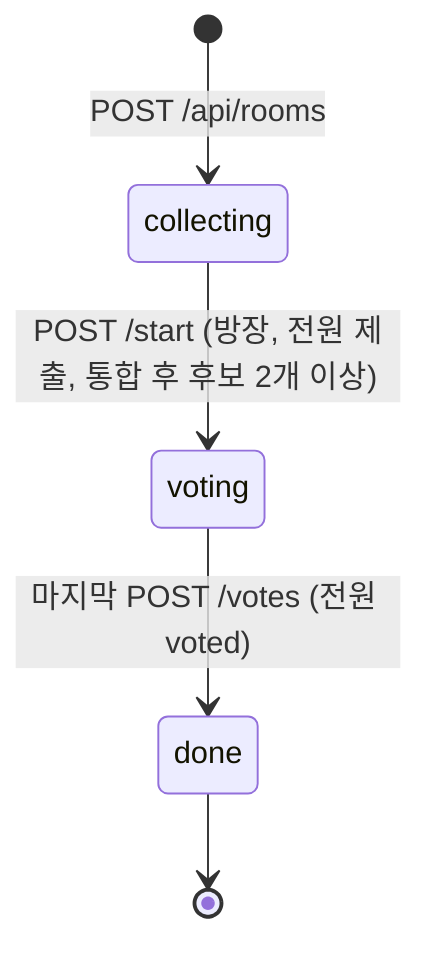
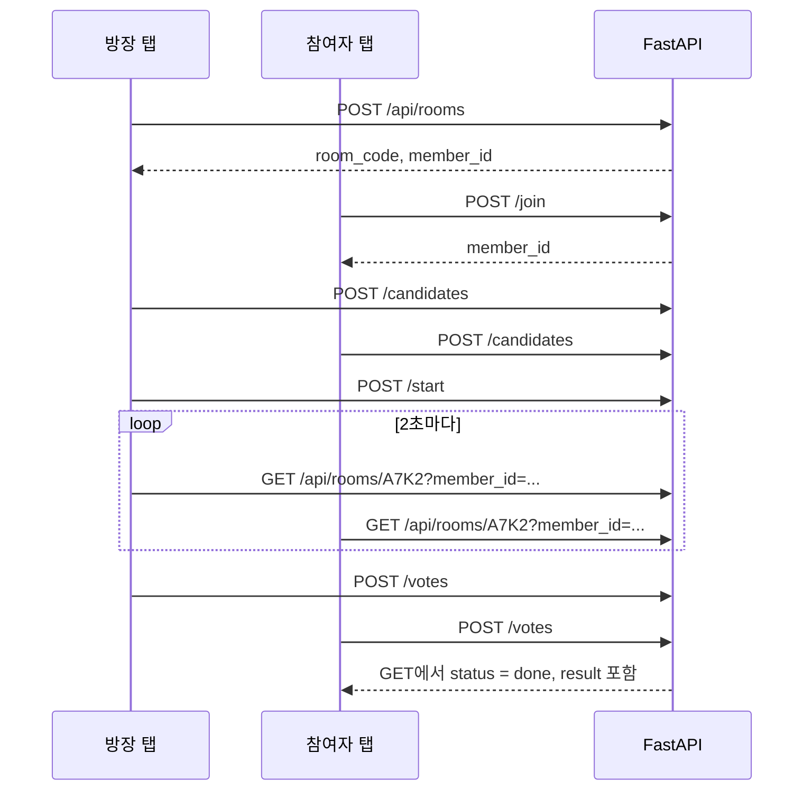

# Design Document

## Overview

"아무거나 말고"는 2~6명의 그룹이 작은 결정을 내릴 때 쓰는 웹앱이다. 방장이 방을 만들고, 참여자가 후보를 한 번씩 제출하고, 카드로 좋아/싫어 투표와 거부권을 낸 뒤, 규칙에 따라 1등이 정해진다.

이 문서는 프론트엔드(`frontend/`, 주영)와 백엔드(`backend/`, 혜린)가 병렬로 개발할 때 기준이 되는 계약서다. API 명세 섹션의 JSON은 기획 페이지의 JSON과 같고, 달라진 부분은 결과 JSON에 `tied_candidates`가 추가된 것 하나뿐이다.

### 기술 스택

| 구분 | 내용 |
|---|---|
| 프론트엔드 | React + TypeScript + Vite + Tailwind CSS v4 (`frontend/`) |
| 백엔드 | Python 3.11 + FastAPI (`backend/`) |
| 저장소 | 백엔드 프로세스 메모리 (서버를 재시작하면 모든 방이 사라진다) |
| 갱신 방식 | 프론트엔드가 2초마다 GET 폴링 |
| 사용자 구분 | 로그인 없음. 방 코드, 닉네임, member_id(UUID) |
| 필드 이름 | snake_case |
| 포트 | 백엔드 8000, 프론트엔드(Vite) 5173 |

### 설계 결정과 이유

| 결정 | 이유 |
|---|---|
| 상태 전이를 `collecting → voting → done` 3단계로 단방향 고정 | 되돌리기가 없어 서버 검증이 단순하고, 프론트 화면 전환 규칙도 상태값 하나로 정해진다. |
| 모든 화면 전환을 폴링한 상태에서 계산 | 별도 실시간 채널 없이 2초 GET 하나로 동기화한다. |
| 투표 중 `candidates`에 추천인을 넣지 않고, 추천인은 결과의 `winner_added_by`에만 둔다 | 익명성 요구사항(투표 중 익명, 최종 1등 외 추천인 비공개)을 응답 모양으로 강제한다. |
| 에러 형식을 `{"detail": "..."}`로 통일 | FastAPI 기본 `HTTPException` 형식과 같아서 별도 변환이 필요 없고, 프론트는 `detail`을 그대로 보여주면 된다. |
| 글자 수 규칙을 양쪽에 같게 구현 | 프론트가 막고, 백엔드는 직접 호출에 대비해 다시 막는다. |

## Architecture

### 전체 구조



### 방 상태 3단계



#### 전이 조건

| 전이 | 트리거 | 조건 | 실패 시 |
|---|---|---|---|
| (없음) → collecting | `POST /api/rooms` | 닉네임 1~10자, topic_type 유효, 주제 유효, 방 코드 발급 성공 | 400 또는 503. 방이 만들어지지 않는다. |
| collecting → voting | `POST /start` | member_id == host_id, 현재 collecting, 전원 submitted, 중복 통합 후 후보 2개 이상 | 403 또는 409. 방은 collecting을 유지하고 후보 목록도 바뀌지 않는다. |
| voting → done | `POST /votes` (자동) | 이 요청으로 방의 모든 Member의 voted가 true가 됨 | 해당 없음. 조건이 되는 즉시 같은 요청 안에서 결과를 계산하고 done으로 바꾼다. |
| done → 없음 | | 종료 상태 | |

#### 상태별로 허용되는 요청

| 요청 | collecting | voting | done |
|---|---|---|---|
| `POST /join` | 허용 | 409 | 409 |
| `POST /candidates` | 허용 (1인 1회) | 409 | 409 |
| `POST /start` | 허용 (방장, 조건 충족 시) | 409 | 409 |
| `POST /votes` | 409 | 허용 (1인 1회) | 409 |
| `GET /api/rooms/{room_code}` | 허용 | 허용 | 허용 |

#### 상태별 GET 응답 규칙

| 필드 | collecting | voting | done |
|---|---|---|---|
| `candidates` | 항상 빈 배열 `[]` (제출 전 비공개) | 통합된 후보. 각 항목은 `candidate_id`, `name`, `appeals`만 포함하고 추천인은 넣지 않는다. | voting과 같은 형태 (추천인 없음) |
| `result` | JSON `null` | JSON `null` | 결과 객체 |
| `members[].submitted` | 후보 제출 여부 | 전원 true | 전원 true |
| `members[].voted` | 모두 false | 투표 제출 여부 | 전원 true |

규칙 요약은 다음과 같다.

1. collecting일 때 `candidates`는 빈 배열이다.
2. voting일 때 `candidates`에는 추천인이 없다.
3. `result`는 status가 `done`일 때만 객체이고, 그 외에는 JSON `null`이다 (확정).

### 화면과 데이터 흐름



## Components and Interfaces

### API 명세

모든 요청 본문과 응답은 JSON이고 필드는 snake_case다. 아래 표의 6개 API가 전부다.

| Method | 주소 | 하는 일 |
|---|---|---|
| POST | /api/rooms | 방 만들기 (주제 포함) → 방 코드 발급 |
| POST | /api/rooms/{room_code}/join | 닉네임으로 참여 |
| POST | /api/rooms/{room_code}/candidates | 내 후보 0~3개를 한 번에 제출 (두 번째 제출은 거절) |
| POST | /api/rooms/{room_code}/start | (방장, 전원 제출 후) 중복 통합 + 투표 시작 |
| POST | /api/rooms/{room_code}/votes | 좋아/싫어 목록 + 거부권 한 번에 제출 |
| GET | /api/rooms/{room_code} | 방 상태 전체 조회 (2초마다) |

#### 1. 방 만들기

방 만들기 요청
```json
{ "host_nickname": "주영", "topic": "오늘 점심 뭐 먹지?", "topic_type": "menu" }
```
응답
```json
{ "room_code": "A7K2", "member_id": "m1" }
```
- topic_type은 menu / movie / place / custom 중 하나
- `member_id`의 `"m1"`, `"m2"`는 설명용 예시다. 실제 값은 UUID 문자열이다 (예: `"3f2b8c1e-5d4a-4e7b-9a10-2c6d8e0f1a3b"`).
- 서버는 이 member_id를 `host_id`로 저장한다.

#### 2. 참여

참여 요청
```json
{ "nickname": "혜린" }
```
응답
```json
{ "member_id": "m2" }
```

#### 3. 후보 제출

후보 제출 요청
```json
{
  "member_id": "m1",
  "candidates": [
    { "name": "마라탕", "appeal": "추워서 얼큰한 거" },
    { "name": "쌀국수", "appeal": "" }
  ]
}
```
- candidates는 0~3개 (빈 배열도 가능 = 후보 없이 제출)

성공 응답 (페이지에 명시되지 않아 이 문서에서 정한다)
```json
{ "ok": true }
```

#### 4. 투표 시작

요청 본문 (페이지에 명시되지 않아 이 문서에서 정한다. "모든 요청에 member_id를 담는다"는 규칙에 따른 유일한 추가 사항이다.)
```json
{ "member_id": "m1" }
```
성공 응답
```json
{ "ok": true }
```

#### 5. 투표 제출

투표 제출 요청
```json
{
  "member_id": "m1",
  "votes": [
    { "candidate_id": "c1", "choice": "like" },
    { "candidate_id": "c2", "choice": "dislike" },
    { "candidate_id": "c3", "choice": "dislike" }
  ],
  "veto_candidate_id": "c2"
}
```
- choice는 like / dislike 두 가지
- 거부권을 안 썼으면 veto_candidate_id는 null
- 거부한 후보는 반드시 본인이 dislike한 후보여야 한다

성공 응답 (페이지에 명시되지 않아 이 문서에서 정한다)
```json
{ "ok": true }
```

#### 6. 방 상태 조회

`GET /api/rooms/{room_code}` 는 선택 쿼리 `?member_id=...` 를 받는다. 응답 모양은 쿼리 유무와 관계없이 같다. `member_id`가 없어도 오류가 아니다.

방 상태 조회 응답 (투표 중 예시)
```json
{
  "room_code": "A7K2",
  "topic": "오늘 점심 뭐 먹지?",
  "topic_type": "menu",
  "status": "voting",
  "host_id": "m1",
  "members": [
    { "member_id": "m1", "nickname": "주영", "submitted": true, "voted": true },
    { "member_id": "m2", "nickname": "혜린", "submitted": true, "voted": false }
  ],
  "candidates": [
    { "candidate_id": "c1", "name": "마라탕", "appeals": ["추워서 얼큰한 거", "어제부터 마라 생각뿐"] },
    { "candidate_id": "c2", "name": "쌀국수", "appeals": [] }
  ],
  "result": null
}
```
- submitted: 후보 제출 완료 여부, voted: 투표 제출 완료 여부
- status가 collecting일 때는 candidates를 빈 배열로 보낸다 (제출 전 비공개)
- 투표 중에는 candidates에 추천인을 넣지 않는다 (익명)
- `candidate_id`는 `"c1"`, `"c2"` 형태의 문자열이며, 투표 시작 시 후보 등록 순서대로 서버가 붙인다.

#### 결과 (status가 done일 때 result): 동점 없음

```json
{
  "winner": "마라탕",
  "winner_added_by": ["주영", "혜린"],
  "winner_appeals": ["추워서 얼큰한 거", "어제부터 마라 생각뿐"],
  "tie_break": null,
  "tied_candidates": [],
  "ranking": [
    { "name": "마라탕", "likes": 4, "dislikes": 0, "vetoed": false },
    { "name": "쌀국수", "likes": 2, "dislikes": 2, "vetoed": false },
    { "name": "곱창", "likes": 1, "dislikes": 3, "vetoed": true }
  ]
}
```

#### 결과: 동점 있음 (랜덤으로 마라탕이 뽑힌 경우)

```json
{
  "winner": "마라탕",
  "winner_added_by": ["주영"],
  "winner_appeals": ["추워서 얼큰한 거"],
  "tie_break": "random",
  "tied_candidates": [
    { "name": "마라탕", "appeals": ["추워서 얼큰한 거"] },
    { "name": "쌀국수", "appeals": ["국물이 필요해"] }
  ],
  "ranking": [
    { "name": "마라탕", "likes": 3, "dislikes": 1, "vetoed": false },
    { "name": "쌀국수", "likes": 3, "dislikes": 1, "vetoed": false },
    { "name": "곱창", "likes": 1, "dislikes": 3, "vetoed": true }
  ]
}
```

- winner_added_by, winner_appeals는 배열
- tie_break는 null 또는 "random"
- ranking, tied_candidates에는 추천인이 없다
- 동점이면 `tied_candidates`에 동점 후보 전원(최종 winner 포함)을 담고, 각 항목은 `name`과 `appeals`만 가진다.
- 동점이 없으면 `tie_break`는 null, `tied_candidates`는 빈 배열이다.
- `winner_added_by`는 최종 winner에 대해서만 내려간다.

### 입력 규칙 (프론트와 백엔드 공통)

| 항목 | 규칙 |
|---|---|
| Nickname | 1~10자. 공백만 있는 값은 빈 값으로 본다. 같은 방 안에서 중복 불가. |
| Appeal | 0~50자 |
| Room_Code | 4자. 영문 대문자와 숫자. 프론트는 입력을 자동으로 대문자로 바꾸고, 백엔드도 받은 값을 대문자로 바꿔서 찾는다. |
| 후보 이름 | 50자 이하. 서버가 400으로 거절하고 프론트는 `maxLength=50`으로 막는다. 글자 수 표시(Char_Counter)는 붙이지 않는다. |
| 주제(topic) | 1~50자. 후보 이름과 같은 방식(서버 400, 프론트 `maxLength=50`, Char_Counter 없음). |
| 후보 개수 | 요청당 0~3개 |
| 방 인원 | 최대 6명 |

글자 수는 "보이는 일반 문자 하나 = 1자"로 센다. 이모지는 이 문서의 범위 밖이며, 일반 문자만 기준으로 한다. 양쪽이 같은 규칙으로 센다(파이썬은 `len(value)`, 프론트는 `value.length`).

### 에러 응답

모든 오류는 다음 형태다.

```json
{ "detail": "사람이 읽을 수 있는 한국어 사유" }
```

#### 상태 코드 매핑

| 코드 | 의미 | 해당하는 경우 |
|---|---|---|
| 400 | 요청 값이 잘못됨 | 닉네임 비어 있음 또는 10자 초과, topic_type이 4가지가 아니거나 누락, topic 비어 있음 또는 50자 초과, 후보가 요청 기준 3개 초과, 후보 이름 50자 초과, Appeal 50자 초과, 투표 항목에 후보 누락·중복·방에 없는 후보 포함, choice가 like/dislike가 아님, 요청 본문 형식 오류(필수 필드 누락 등, FastAPI 기본 422를 400으로 변환) |
| 403 | 권한 없음 | 방장 전용 요청(`/start`)의 member_id가 host_id와 다르거나 누락이거나 빈 문자열, 요청한 member_id가 그 방의 참여자가 아님 |
| 404 | 없음 | 해당 방 코드의 방이 없음 |
| 409 | 현재 상태와 충돌 | 정원 6명 초과, 같은 방 닉네임 중복, 방 상태가 요청과 맞지 않음, 이미 후보를 제출함, 이미 투표를 제출함, 전원 제출 전에 투표 시작, 통합 후 후보 2개 미만, 거부권 대상이 본인이 dislike한 후보가 아님 |
| 503 | 일시적으로 처리 불가 | 방 코드를 발급하지 못함 |

주의할 점은 다음과 같다.

- 거부권 대상이 본인이 dislike한 후보가 아닌 경우는 409로 매핑한다. 이 항목은 입력 값 형식 문제가 아니라 본인의 투표 내용과 충돌하는 경우다.
- 후보 이름이 비어 있거나 공백만 있는 경우는 오류가 아니다. 400 행에 포함하지 않는다. 아래 "빈 이름 후보 처리"를 따른다.
- 같은 번호의 응답이라도 `detail` 문구는 사유마다 다르다.

#### 빈 이름 후보 처리

후보 이름이 비어 있거나 공백만 있는 후보는 400으로 거절하지 않는다. 요구사항에 따라 그 후보 하나만 조용히 무시하고(오류 없음) 나머지 후보를 저장한다. 모든 후보가 무시되면 후보 0개 제출로 보고 `submitted = true`로 바꾼 뒤 200 `{"ok": true}`를 응답한다. 후보 이름이 50자를 넘으면 여전히 400이다. "후보 3개 초과 → 400" 검사는 요청에 담겨 온 후보 개수를 그대로 센다(빈 이름 후보도 개수에 포함).

#### 주요 `detail` 문구

| 상황 | 코드 | detail |
|---|---|---|
| 중복 통합 후 후보 2개 미만 | 409 | `중복을 합치고 나니 후보가 2개 미만이에요. 새 참여자를 기다리거나 새 방을 만들어 주세요.` |
| 전원 제출 전 투표 시작 | 409 | `아직 후보를 제출하지 않은 사람이 있어요.` |
| 방장이 아님 | 403 | `방장만 투표를 시작할 수 있어요.` |
| 방이 없음 | 404 | `방을 찾을 수 없어요.` |
| 정원 초과 | 409 | `방이 가득 찼어요. (최대 6명)` |
| 닉네임 중복 | 409 | `이미 같은 닉네임이 있어요.` |
| 방 코드 발급 실패 | 503 | `방 코드를 만들지 못했어요. 잠시 후 다시 시도해 주세요.` |

### 백엔드 컴포넌트

#### 파일 구성 (`backend/`)

```
backend/
├── main.py        # FastAPI 앱, CORS, 라우트 6개, 예외 핸들러
├── schemas.py     # 요청/응답 Pydantic 모델
├── store.py       # 메모리 저장소 (rooms 딕셔너리, 방 코드 발급)
├── services.py    # 검증, 중복 통합, 결과 계산
└── errors.py      # ApiError(status_code, detail)
```

#### 라우트와 서비스 함수

| 라우트 | 서비스 함수 |
|---|---|
| `POST /api/rooms` | `create_room(host_nickname, topic, topic_type)` |
| `POST /api/rooms/{room_code}/join` | `join_room(room_code, nickname)` |
| `POST /api/rooms/{room_code}/candidates` | `submit_candidates(room_code, member_id, candidates)` |
| `POST /api/rooms/{room_code}/start` | `start_voting(room_code, member_id)` |
| `POST /api/rooms/{room_code}/votes` | `submit_votes(room_code, member_id, votes, veto_candidate_id)` |
| `GET /api/rooms/{room_code}` | `get_room_state(room_code)` |

#### CORS

`http://localhost:5173` 출처를 허용한다.

```python
from fastapi.middleware.cors import CORSMiddleware

app.add_middleware(
    CORSMiddleware,
    allow_origins=["http://localhost:5173"],
    allow_methods=["*"],
    allow_headers=["*"],
)
```

#### 요청 검증 순서

본문 형식 오류는 맨 앞에서 400으로 처리한다. 그 뒤 엔드포인트마다 아래 순서로 검사하고, 처음 걸린 오류를 응답한다. 어떤 오류가 나도 저장된 데이터는 바뀌지 않는다(검사를 모두 통과한 뒤에만 한 번에 반영한다).

| 엔드포인트 | 순서 |
|---|---|
| `POST /api/rooms` | 1) 닉네임 1~10자(400) → 2) topic_type 유효(400) → 3) topic 1~50자(400) → 4) 방 코드 발급(503) |
| `POST /join` | 1) 방 존재(404) → 2) 닉네임 1~10자(400) → 3) status가 collecting(409) → 4) 인원 6명 미만(409) → 5) 닉네임 중복 아님(409) |
| `POST /candidates` | 1) 방 존재(404) → 2) member_id가 방의 참여자(403) → 3) status가 collecting(409) → 4) 아직 제출 안 함(409) → 5) 요청 후보 개수 3개 이하(400) → 6) 이름이 비지 않은 후보의 이름 50자 이하, Appeal 50자 이하(400) → 7) 빈 이름 후보를 제외하고 저장 |
| `POST /start` | 1) 방 존재(404) → 2) member_id == host_id (403) → 3) status가 collecting(409) → 4) 전원 submitted(409) → 5) 통합 후 후보 2개 이상(409) → 6) 통합 확정, voting으로 변경 |
| `POST /votes` | 1) 방 존재(404) → 2) member_id가 방의 참여자(403) → 3) status가 voting(409) → 4) 아직 투표 안 함(409) → 5) 항목이 모든 후보를 정확히 한 번씩 담고 choice가 유효(400) → 6) veto_candidate_id가 null이거나 본인이 dislike한 후보(409) → 7) 저장, 전원 voted이면 결과 계산 |
| `GET` | 방 존재(404). `member_id` 쿼리는 검사하지 않는다. |

#### 중복 통합 알고리즘

투표 시작(`/start`) 시점에 한 번만 수행한다. 이모지는 범위 밖이므로 일반 문자만 다룬다.

```python
import re

def normalize(name: str) -> str:
    # 앞, 뒤, 중간의 모든 공백을 제거하고 영문을 소문자로 바꾼다
    return re.sub(r"\s+", "", name).lower()

def merge_candidates(raw_candidates):
    """raw_candidates: 제출 순서대로 정렬된 Candidate 목록
       각 항목: name, appeal, added_by(nickname)"""
    groups = {}          # normalized -> MergedCandidate (삽입 순서 유지)
    for c in raw_candidates:
        key = normalize(c.name)
        if key not in groups:
            groups[key] = MergedCandidate(
                name=c.name,        # 가장 먼저 제출된 표기
                appeals=[],
                added_by=[],
            )
        m = groups[key]
        if c.appeal != "":
            m.appeals.append(c.appeal)      # 등록 순서, 하나도 빼지 않음
        if c.added_by not in m.added_by:
            m.added_by.append(c.added_by)   # 중복 없이 기록 (내부용)
    merged = list(groups.values())
    for i, m in enumerate(merged, start=1):
        m.candidate_id = f"c{i}"
    return merged
```

- 이름이 정확히 같을 때만 합친다. 한 글자라도 다르면 다른 후보다.
- 같은 사람이 같은 이름(정규화 기준)을 두 번 낸 경우도 하나로 합친다.
- Appeal이 빈 문자열인 후보는 `appeals`에 넣지 않는다.
- 이름은 먼저 제출된 후보의 표기를 쓴다. "먼저"는 전체 Candidate의 등록 순서(제출 시각 순서, 같은 제출 안에서는 배열 순서)다.
- 합친 결과가 2개 미만이면 통합 결과를 버리고 409를 응답한다. 방은 collecting이고 원본 후보 목록(`raw_candidates`)은 그대로다.
- 통합이 확정되면 `Room.candidates`(Merged)가 채워지고 status가 `voting`이 된다.

#### 결과 계산 의사코드

모든 Member의 `voted`가 true가 되는 순간, 마지막 `/votes` 요청 안에서 실행한다.

```python
import random

def compute_result(room):
    cands = room.merged_candidates            # 등록 순서 유지
    stats = {}
    for c in cands:
        stats[c.candidate_id] = {"likes": 0, "dislikes": 0, "vetoes": 0}
    for v in room.votes:                      # Vote: member_id, votes, veto_candidate_id
        for item in v.votes:
            key = "likes" if item.choice == "like" else "dislikes"
            stats[item.candidate_id][key] += 1   # 거부한 후보의 dislike도 싫어 1표로 이미 포함
        if v.veto_candidate_id is not None:
            stats[v.veto_candidate_id]["vetoes"] += 1

    vetoed = {cid for cid, s in stats.items() if s["vetoes"] >= 1}

    # 1) 거부권 받은 후보 제외
    pool = [c for c in cands if c.candidate_id not in vetoed]
    # 5) 모두 거부권을 받았다면 거부권을 가장 적게 받은 후보들만
    if not pool:
        least = min(s["vetoes"] for s in stats.values())
        pool = [c for c in cands if stats[c.candidate_id]["vetoes"] == least]

    # 2, 3) 좋아요 많은 순, 같으면 싫어요 적은 순 (같은 값이면 등록 순서 유지: 파이썬 sort는 안정 정렬)
    def sort_key(c):
        s = stats[c.candidate_id]
        return (-s["likes"], s["dislikes"])

    pool_sorted = sorted(pool, key=sort_key)
    rest = [c for c in cands if c not in pool]
    rest_sorted = sorted(rest, key=sort_key)

    # 4) 1등 동점 처리
    top_key = sort_key(pool_sorted[0])
    tied = [c for c in pool_sorted if sort_key(c) == top_key]
    if len(tied) >= 2:
        winner = random.choice(tied)          # 각 1/N
        tie_break = "random"
        tied_candidates = [{"name": c.name, "appeals": list(c.appeals)} for c in tied]
        # winner를 ranking 맨 앞으로 옮긴다
        pool_sorted = [winner] + [c for c in pool_sorted if c is not winner]
    else:
        winner = pool_sorted[0]
        tie_break = None
        tied_candidates = []

    ranking_cands = pool_sorted + rest_sorted
    ranking = [
        {"name": c.name,
         "likes": stats[c.candidate_id]["likes"],
         "dislikes": stats[c.candidate_id]["dislikes"],
         "vetoed": c.candidate_id in vetoed}
        for c in ranking_cands
    ]
    return {
        "winner": winner.name,
        "winner_added_by": list(winner.added_by),   # 최종 winner만 추천인 공개
        "winner_appeals": list(winner.appeals),
        "tie_break": tie_break,
        "tied_candidates": tied_candidates,
        "ranking": ranking,
    }
```

랭킹 규칙을 요약하면 다음과 같다. 1등 후보군(거부권을 받지 않은 후보, 모두 받았다면 거부권을 가장 적게 받은 후보들)을 좋아요 많은 순, 싫어요 적은 순으로 먼저 늘어놓고, 그 뒤에 나머지 후보를 같은 기준으로 늘어놓는다. `ranking[0]`이 winner다. `vetoed`는 한 표라도 거부권을 받았는지를 나타내므로, 모든 후보가 거부된 경우 1등 후보군 안에도 `vetoed: true`가 있을 수 있다.

#### 메모리 모델 (`store.py`)

```python
@dataclass
class Member:
    member_id: str            # uuid4 문자열
    nickname: str
    submitted: bool = False
    voted: bool = False

@dataclass
class Candidate:              # 제출된 원본 후보 (내부용)
    name: str
    appeal: str
    added_by: str             # 제출자 nickname. API 응답에는 노출하지 않는다.
    order: int                # 등록 순서 (방 전체에서 증가)

@dataclass
class MergedCandidate:        # 투표 시작 후 확정된 후보
    candidate_id: str         # "c1", "c2", ...
    name: str
    appeals: list[str]
    added_by: list[str]       # 내부용. result.winner_added_by에만 사용

@dataclass
class Vote:
    member_id: str
    votes: list[dict]         # {"candidate_id": str, "choice": "like" | "dislike"}
    veto_candidate_id: str | None

@dataclass
class Room:
    room_code: str
    topic: str
    topic_type: str
    status: str               # "collecting" | "voting" | "done"
    host_id: str
    members: list[Member]     # 가입 순서
    raw_candidates: list[Candidate]
    merged_candidates: list[MergedCandidate]
    votes: list[Vote]
    result: dict | None

rooms: dict[str, Room] = {}   # key: 대문자 room_code
```

- 방 코드는 `ABCDEFGHIJKLMNOPQRSTUVWXYZ0123456789`에서 4자를 무작위로 뽑는다. 이미 있는 코드와 겹치면 다시 뽑고, 일정 횟수(예: 20번)를 시도해도 실패하면 503을 응답한다.
- GET 응답은 `Room`에서 만들어 낸다. `raw_candidates`와 `added_by`는 `result.winner_added_by`를 제외하고 응답에 쓰지 않는다.
- 방 코드 조회는 `room_code.strip().upper()`로 한다.

### 프론트엔드 컴포넌트

#### 파일 구성 (`frontend/src/`)

```
frontend/src/
├── main.tsx
├── App.tsx                 # 폴링, 화면 전환 규칙
├── index.css               # @import "tailwindcss"; + @theme 팔레트
├── api.ts                  # USE_MOCK 스위치, API 호출 함수 6개
├── mock.ts                 # 목 데이터 (JSON 예시 기반)
├── types.ts                # API 타입 (snake_case 그대로)
├── session.ts              # sessionStorage 도우미
├── lib/text.ts             # 글자 수 자르기, 정규화 도우미
├── components/
│   ├── LimitedInput.tsx    # maxLength + 붙여넣기 자르기 + Char_Counter
│   ├── FlipCard.tsx        # 카드 뒤집기
│   └── InlineMessage.tsx   # 입력 아래에 나오는 오류/안내 문구
└── screens/
    ├── Home.tsx
    ├── Lobby.tsx           # 대기실 + 후보 제출
    ├── CardVote.tsx
    ├── Veto.tsx
    ├── Waiting.tsx
    └── Result.tsx
```

#### api.ts 인터페이스

```ts
export const USE_MOCK = true; // 백엔드가 준비되면 false

export const API_BASE = "http://localhost:8000";

export function createRoom(req: CreateRoomReq): Promise<{ room_code: string; member_id: string }>;
export function joinRoom(roomCode: string, req: { nickname: string }): Promise<{ member_id: string }>;
export function submitCandidates(roomCode: string, req: SubmitCandidatesReq): Promise<{ ok: true }>;
export function startVoting(roomCode: string, req: { member_id: string }): Promise<{ ok: true }>;
export function submitVotes(roomCode: string, req: SubmitVotesReq): Promise<{ ok: true }>;
export function getRoom(roomCode: string, memberId?: string): Promise<RoomState>;
```

- 모든 호출은 같은 규칙으로 오류를 처리한다. HTTP 상태가 2xx가 아니면 응답 본문의 `detail`을 담은 `ApiError(status, detail)`을 던진다. 네트워크 오류는 `status = 0`으로 구분한다.
- `USE_MOCK`이 true이면 네트워크를 쓰지 않고 `mock.ts`의 데이터를 돌려준다.
- 목 데이터는 위 JSON 예시에서 가져온다. 방 상태 3종(collecting, voting, done)을 만들고, done에는 결과 두 가지(동점 없음, 동점 있음)를 모두 둔다. 화면 개발 중에 동점 결과를 바로 볼 수 있어야 한다.

#### sessionStorage 도우미 (`session.ts`)

| 함수 | 하는 일 |
|---|---|
| `saveSession({ room_code, member_id, nickname })` | 세 값을 `sessionStorage`에 저장 |
| `loadSession()` | 세 값이 모두 있으면 객체, 아니면 `null` |
| `clearSession()` | 세 값을 지움 |

- 키는 `room_code`, `member_id`, `nickname`.
- 탭마다 따로 저장되는 `sessionStorage`만 쓴다. `localStorage`는 사용하지 않는다.
- 방 만들기 또는 참여가 성공했을 때만 저장한다. 참여가 거절되면 저장하지 않고 입력칸 값을 그대로 둔다.

#### 입력칸 규칙 (`LimitedInput`)

| 입력칸 | 최대 | Char_Counter | 비고 |
|---|---|---|---|
| Nickname | 10 | `(현재/10)` | 비어 있으면 흐린 placeholder "닉네임은 한 글자 이상 입력해주세요."를 표시하고, 한 글자라도 입력하면 사라진다. |
| Appeal | 50 | `(현재/50)` | |
| Room_Code | 4 | `(현재/4)` | 입력 값을 자동으로 대문자로 바꾼다. 영문 대문자와 숫자만 받는다. |
| 후보 이름 | 50 | 없음 | `maxLength=50`만 건다. |
| 주제(직접 입력) | 50 | 없음 | `maxLength=50`만 건다. |

- Char_Counter는 입력칸 옆에 "(3/10)" 형식으로 둔다.
- `maxLength`를 걸고, 붙여넣기는 `onChange`에서 `value.slice(0, max)`로 잘라서 최대 글자 수까지만 들어가게 한다.
- 글자 수 제한 때문에 팝업, 모달, `alert`을 띄우지 않는다.
- 최대 글자 수를 넘는 값은 서버로 보내지 않는다. 백엔드는 직접 호출에 대비해 초과와 빈 값을 다시 400으로 거절한다.
- 주제 버튼의 기본 문구는 다음과 같다. 선택한 버튼의 문구가 `topic`으로 들어가고, "직접 입력"은 사용자가 쓴 문구를 쓴다.

| 버튼 | topic_type | 기본 문구 |
|---|---|---|
| 🍽️ 메뉴 | `menu` | 오늘 뭐 먹지? |
| 🎬 영화 | `movie` | 오늘 뭐 볼까? |
| 📍 장소 | `place` | 어디 갈까? |
| ✏️ 직접 입력 | `custom` | (사용자 입력) |

#### 화면 6개

| 화면 | 보여주는 내용 |
|---|---|
| 홈 | 서비스 소개 한 줄, "방 만들기", "코드로 참여하기", Nickname 입력. 방 만들기를 누르면 주제 버튼 3개와 직접 입력칸. 코드로 참여하기를 누르면 Room_Code 입력칸. |
| 대기실 + 후보 제출 | Topic(참여자 목록보다 큰 글자), Room_Code, 참여자 목록, "6명 중 4명 제출 완료". 후보 입력칸 3개와 Appeal 칸, 안내 문구, 제출 버튼. 방장에게만 "투표 시작" 버튼. |
| 카드 투표 | 상단 Topic, 카드 한 장, 하단 좋아/싫어 버튼, "3 / 7" 진행 표시 |
| 거부권 | "거부권은 딱 1장!", 내가 dislike한 후보 목록, "거부 안 할래요", "이걸로 거부" |
| 기다리는 중 | "6명 중 3명 완료", 참여자별 완료 표시 |
| 결과 공개 | "{Topic}의 결과는…", 👑 winner, Appeal 목록, "추천인 : 주영, 혜린", 나머지 순위(좋아요/싫어요, 🚫) |

#### 화면 전환 규칙

화면은 폴링한 방 상태(`status`, 내 `submitted`, 내 `voted`)와 프론트의 로컬 투표 진행 상태로 정한다. 위에서부터 처음 맞는 규칙을 쓴다.

| 순서 | 조건 | 화면 |
|---|---|---|
| 1 | sessionStorage에 세션이 없음 | 홈 |
| 2 | GET이 404를 응답 | "방을 찾을 수 없어요" 안내와 홈으로 가는 버튼. 폴링을 멈춘다. |
| 3 | `status == "done"` | 결과 공개 |
| 4 | `status == "voting"` 이고 내 `voted == true` | 기다리는 중 |
| 5 | `status == "voting"` 이고 로컬 단계가 `cards` | 카드 투표 |
| 6 | `status == "voting"` 이고 로컬 단계가 `veto` | 거부권 |
| 7 | `status == "voting"` 이고 로컬 단계가 `submitting` | 기다리는 중 (제출 중) |
| 8 | `status == "collecting"` | 대기실 + 후보 제출 (내 `submitted`가 true이면 입력칸 비활성) |

로컬 투표 진행 상태는 다음과 같이 움직인다.

- `cards`: 카드를 한 장씩 보며 선택을 쌓는다. 마지막 카드까지 선택하면, dislike가 1개 이상이면 `veto`로, 하나도 없으면 거부권 없이 바로 `submitting`으로 간다.
- `veto`: "거부 안 할래요"(null) 또는 "이걸로 거부"(dislike한 후보 1개)로 `submitting`으로 간다. 후보를 다시 고르면 이전 선택은 해제되어 항상 최대 1개다.
- `submitting`: `POST /votes`를 한 번 보낸다. 실패하면 오류 사유를 보여 주고 선택 내용을 유지한 채 재제출할 수 있게 한다.
- 폴링 응답이 `voted == true`가 되면 로컬 상태와 관계없이 기다리는 중 화면으로 간다.
- 새로고침하면 로컬 투표 진행은 처음 카드부터 다시 시작한다. 이미 제출했다면 서버의 `voted`가 true이므로 기다리는 중으로 간다.

#### 폴링

- 세션이 있고 방이 있는 동안 2초마다 `getRoom(room_code, member_id)`를 호출한다.
- 네트워크 오류(`status = 0`)가 나면 마지막 성공 화면을 유지하고 다음 주기에 다시 호출한다.
- 404이면 폴링을 멈추고 홈으로 가는 버튼이 있는 안내를 보여준다.
- `done`이 되면 결과 화면으로 가고 더 이상 폴링하지 않아도 된다.

#### 투표 시작 실패 처리

방장이 "투표 시작"을 눌렀을 때 오류(전원 미제출 409, 후보 2개 미만 409, 권한 없음 403, 상태 오류 409)가 오면, 응답의 `detail`을 "투표 시작" 버튼 바로 아래에 인라인 문구로 보여준다. 모달이나 팝업은 쓰지 않는다. 방은 collecting을 유지한다. 방 상태가 바뀌거나 사용자가 버튼을 다시 누르면 문구를 지운다.

#### 디자인

테라코타를 포인트 색으로 쓰고 작은 팔레트로 통일한다. Tailwind CSS v4의 `@theme`에 정의한다.

```css
@import "tailwindcss";

@theme {
  --color-terracotta-500: #c8553d;  /* 포인트: 주요 버튼, 강조 */
  --color-terracotta-100: #f6dfd8;  /* 연한 배경, 선택 상태 */
  --color-cream-50: #fbf6ef;        /* 페이지 배경 */
  --color-ink-900: #2b2420;         /* 본문 글자 */
  --color-ink-400: #8a7f77;         /* 보조 글자, placeholder */
}
```

#### 카드 뒤집기

- 카드 영역을 탭하면 앞면(후보 이름)과 뒷면(Appeal 목록)이 뒤집힌다.
- 카드 안의 버튼(좋아, 싫어)을 누를 때는 뒤집히지 않는다. 버튼 클릭 이벤트에서 `stopPropagation()`을 호출한다. 좋아/싫어 버튼은 카드 아래에 항상 보인다.
- 선택하면 다음 카드를 앞면 상태로 보여준다.
- Appeal이 없으면 뒷면에 "어필 없이 등록된 후보예요 🤐"를 표시한다.
- 뒷면에는 Appeal만 보이고 작성자 정보는 없다.

#### 결과 공개 흐름

- 동점이 없는 경우(`tied_candidates`가 빈 배열): "{Topic}의 결과는…"과 함께 👑 winner, Appeal 목록 전체, "추천인 : 주영, 혜린", 나머지 후보의 순위를 한 화면에 보여준다. 나머지 후보 옆에는 좋아요 수, 싫어요 수를 보여주고 거부권을 받은 후보 옆에는 🚫를 붙인다. 나머지 후보의 추천인은 표시하지 않는다.
- 동점이 있는 경우(`tied_candidates`가 비어 있지 않음): 먼저 동점 후보들과 각각의 Appeal을 함께 보여준다. 그 표시가 끝나면 랜덤으로 정해진 winner를 👑과 함께 공개하고, 이어서 위의 일반 결과 내용을 보여준다.
- 결과 데이터를 못 불러오면 오류 문구와 "다시 시도" 버튼을 보여주고, 버튼을 누르면 다시 요청한다.

#### Should 항목 (필수 아님)

시간 여유가 있을 때만 구현하며, 구현하지 않아도 위 내용의 완료에는 영향이 없다.

| 항목 | 내용 |
|---|---|
| 두구두구 결과 공개 연출 | 결과 공개 전에 "두구두구" 연출을 보여준다. 동점이면 동점 후보 표시를 끝낸 뒤에 연출하고, 연출이 진행되는 동안 winner 이름과 👑은 숨긴다. |
| 아무고릴라 문구 | 마스코트 "아무고릴라"(생일 11/14, 말버릇 "고릴래?")의 문구를 로딩 화면과 결과 공개 연출에서만 쓴다. 말버릇은 "고릴래?"를 그대로 쓴다. |

### 실행 방법

백엔드 (`backend/` 폴더에서)

| OS | 명령 |
|---|---|
| Windows (cmd) | `python -m venv .venv && .venv\Scripts\activate && pip install fastapi uvicorn && uvicorn main:app --reload --port 8000` |
| macOS | `python3 -m venv .venv && source .venv/bin/activate && pip install fastapi uvicorn && uvicorn main:app --reload --port 8000` |

프론트엔드 (`frontend/` 폴더에서, 두 OS 공통)

```
npm install && npm run dev
```

- 명령은 `&&`로만 연결한다.
- 프론트엔드는 `http://localhost:5173`, 백엔드는 `http://localhost:8000`에서 열린다.

## Data Models

### 요청 타입 (TypeScript)

```ts
type TopicType = "menu" | "movie" | "place" | "custom";
type RoomStatus = "collecting" | "voting" | "done";
type Choice = "like" | "dislike";

interface CreateRoomReq { host_nickname: string; topic: string; topic_type: TopicType }
interface SubmitCandidatesReq {
  member_id: string;
  candidates: { name: string; appeal: string }[];   // 0~3개
}
interface SubmitVotesReq {
  member_id: string;
  votes: { candidate_id: string; choice: Choice }[];
  veto_candidate_id: string | null;
}
```

### 응답 타입 (TypeScript)

```ts
interface Member { member_id: string; nickname: string; submitted: boolean; voted: boolean }
interface PublicCandidate { candidate_id: string; name: string; appeals: string[] }
interface RankingItem { name: string; likes: number; dislikes: number; vetoed: boolean }
interface TiedCandidate { name: string; appeals: string[] }

interface RoomResult {
  winner: string;
  winner_added_by: string[];
  winner_appeals: string[];
  tie_break: "random" | null;
  tied_candidates: TiedCandidate[];
  ranking: RankingItem[];
}

interface RoomState {
  room_code: string;
  topic: string;
  topic_type: TopicType;
  status: RoomStatus;
  host_id: string;
  members: Member[];
  candidates: PublicCandidate[];   // collecting이면 [], voting/done이면 추천인 없는 후보
  result: RoomResult | null;       // done일 때만 객체
}

interface ApiErrorBody { detail: string }
```

### 필드 의미와 제약

| 필드 | 제약 |
|---|---|
| `room_code` | 4자, 영문 대문자와 숫자 |
| `member_id` | UUID 문자열 (예시의 `m1`, `m2`는 설명용) |
| `host_id` | 방을 만든 사람의 member_id. 바뀌지 않는다. |
| `candidate_id` | 투표 시작 때 서버가 붙이는 `c1`, `c2`, ... |
| `tie_break` | `null` 또는 `"random"` |
| `result` | `status == "done"`일 때만 객체, 그 외에는 JSON `null` |

## Correctness Properties

*A property is a characteristic or behavior that should hold true across all valid executions of a system-essentially, a formal statement about what the system should do. Properties serve as the bridge between human-readable specifications and machine-verifiable correctness guarantees.*

속성 반영(Reflection) 결과, 같은 입력과 같은 검증을 공유하는 항목은 하나로 합쳤다. 예를 들어 방 만들기와 참여의 닉네임 검증은 속성 1 하나로, 후보 제출의 개수·길이·빈 이름 처리는 속성 6 하나로 정리했다. 이 문서에서는 속성을 기록만 하며, 이를 구현하는 테스트 작업은 만들지 않는다.

### Property 1: 닉네임 검증

*For any* 문자열 nickname에 대해, 방 만들기와 참여 요청은 nickname이 공백만 있는 값이 아니고 길이가 1~10자일 때만 성공해야 하며, 그 외에는 400으로 거절되고 방과 참여자 목록은 바뀌지 않아야 한다.

**Validates: Requirements 1.4, 1.6, 2.2, 2.5, 13.7**

### Property 2: Room_Code 형식과 유일성

*For any* 동시에 존재하는 방들의 집합에 대해, 발급된 모든 room_code는 영문 대문자와 숫자로 이루어진 4자이고 서로 달라야 한다. 또한 소문자나 공백이 섞여 들어온 코드는 대문자로 바꾼 뒤 같은 방을 가리켜야 한다.

**Validates: Requirements 1.4, 1.8**

### Property 3: 참여 규칙

*For any* 방 상태(status, 인원 수, 기존 닉네임 집합)와 유효한 닉네임에 대해, 참여는 status가 collecting이고 인원이 6명 미만이며 같은 닉네임이 없을 때만 성공해야 하고, 거절되면 참여자 목록은 바뀌지 않아야 한다.

**Validates: Requirements 2.2, 2.4, 2.6, 2.7**

### Property 4: 상태별 공개 규칙

*For any* 방과 그 방의 모든 상태(collecting, voting, done)에서의 GET 응답에 대해, collecting이면 `candidates`는 빈 배열이어야 하고, voting과 done이면 `candidates` 항목에 추천인 정보가 없어야 하며, `result`는 status가 done일 때만 null이 아니어야 한다.

**Validates: Requirements 3.6, 3.7, 3.8**

### Property 5: 방장만 투표 시작

*For any* member_id(누락, 빈 문자열, 다른 참여자의 값 포함)에 대해, `/start`는 member_id가 host_id와 정확히 같을 때만 처리되어야 하고, 그렇지 않으면 403을 응답하며 방의 상태, host_id, 참여자 목록은 바뀌지 않아야 한다.

**Validates: Requirements 4.1, 4.2**

### Property 6: 후보 제출 검증과 빈 이름 무시

*For any* 후보 제출 요청에 대해, 요청에 담긴 후보가 3개를 넘거나 이름이나 Appeal이 50자를 넘으면 400으로 거절되고 저장 데이터와 `submitted`는 바뀌지 않아야 하며, 그렇지 않으면 이름이 비어 있거나 공백뿐인 후보만 제외하고 나머지가 저장되고 `submitted`가 true가 되어야 한다(전부 제외되어도 성공).

**Validates: Requirements 5.4, 5.5, 5.6, 5.7**

### Property 7: 1인 1회 제출

*For any* 이미 후보를 제출한 Member에 대해, 같은 Member의 두 번째 후보 제출과, 이미 투표를 제출한 Member의 두 번째 투표 제출은 409로 거절되어야 하고, 첫 번째 제출의 저장 내용은 바뀌지 않아야 한다.

**Validates: Requirements 5.8, 9.7**

### Property 8: 중복 통합의 동치 기준

*For any* 두 후보 이름 a, b에 대해, 두 이름이 통합 후 같은 후보가 되는 것은 `normalize(a) == normalize(b)`일 때, 즉 모든 공백을 제거하고 영문을 소문자로 바꾼 문자열이 완전히 같을 때뿐이어야 한다.

**Validates: Requirements 6.6, 6.7, 6.8**

### Property 9: 통합 결과의 보존

*For any* 제출된 후보 목록에 대해, 통합된 각 후보의 이름은 같은 그룹에서 가장 먼저 등록된 후보의 표기여야 하고, `appeals`는 그룹에 속한 모든 비어 있지 않은 Appeal을 등록 순서대로 하나도 빠짐없이 담아야 하며, 추천인은 중복 없이 기록되어야 한다.

**Validates: Requirements 6.9, 6.10, 6.11**

### Property 10: 투표 시작 조건

*For any* collecting 상태의 방에 대해, `/start`는 전원이 제출했고 통합 후 후보가 2개 이상일 때만 voting으로 바꾸어야 하며, 그렇지 않으면 409로 거절되고 status는 collecting이며 후보 원본 목록은 바뀌지 않아야 한다.

**Validates: Requirements 6.3, 6.4, 6.5, 6.12**

### Property 11: 투표 제출 검증

*For any* 투표 제출에 대해, 모든 통합 후보에 대해 choice가 정확히 하나씩 있고 `veto_candidate_id`가 null이거나 본인이 dislike한 후보일 때만 저장되어야 하고, 그렇지 않으면 거절되며 해당 Member의 `voted`와 기존 저장 데이터는 바뀌지 않아야 한다.

**Validates: Requirements 9.4, 9.5, 9.6**

### Property 12: 순위 규칙

*For any* 후보 집합과 투표 집합에 대해, 결과의 `ranking` 앞부분은 1등 후보군(거부권을 받지 않은 후보, 모두 받았다면 거부권을 가장 적게 받은 후보들)이어야 하고, 각 구간은 좋아요 수 내림차순, 같으면 싫어요 수 오름차순으로 정렬되어야 하며, `likes`와 `dislikes`는 거부한 후보의 dislike를 싫어 1표로 포함해 계산되어야 한다. 또한 `vetoed`는 거부권을 한 표라도 받았을 때만 true여야 한다.

**Validates: Requirements 10.2, 10.3, 10.4, 10.5, 10.6, 10.9**

### Property 13: 동점 처리의 일관성

*For any* 결과에 대해, 1등 후보군에서 최고 순위가 둘 이상 동점이면 `tie_break`는 `"random"`이고 `tied_candidates`는 동점 후보 전원(winner 포함)을 담으며 winner는 그중 하나이어야 하고, 동점이 없으면 `tie_break`는 null이고 `tied_candidates`는 빈 배열이어야 한다. 어느 경우에도 `ranking[0].name == winner`이어야 하고, `winner_appeals`는 winner의 모든 Appeal과 같아야 한다.

**Validates: Requirements 10.7, 10.8, 11.1, 11.2, 11.4, 11.5, 11.6**

### Property 14: 추천인 노출 제한

*For any* 결과에 대해, `ranking`과 `tied_candidates`의 항목은 추천인 정보를 담지 않아야 하고, 추천인은 `winner_added_by`로 최종 winner에 대해서만 내려가야 하며, 누가 어떻게 투표했는지와 누가 거부권을 썼는지는 어떤 응답에도 없어야 한다.

**Validates: Requirements 9.11, 10.9, 11.3, 11.7, 12.9**

### Property 15: 글자 수 자르기

*For any* 입력 문자열과 최대 글자 수 N에 대해, 입력칸에 반영되는 값은 입력 문자열의 앞 N자이며, 길이가 N 이하이면 입력과 같아야 한다.

**Validates: Requirements 13.3, 13.4, 13.6**

## Error Handling

### 백엔드

- 모든 오류는 `ApiError(status_code, detail)`로 던지고, 하나의 핸들러가 `{"detail": "..."}` 형태로 응답한다.
- FastAPI의 요청 본문 검증 오류(기본 422)는 별도 핸들러에서 400 `{"detail": "..."}`으로 바꾼다.
- 상태를 바꾸는 요청은 모든 검사를 통과한 뒤에만 저장한다. 도중에 거절되어도 데이터는 바뀌지 않는다.
- 상태 코드와 사유는 위 "상태 코드 매핑"과 "주요 detail 문구"를 따른다.
- 동시 요청: FastAPI 단일 프로세스에서 상태를 바꾸는 서비스 함수는 `threading.Lock` 하나로 보호해 동시에 두 번째 제출이 들어와도 한 번만 반영되게 한다.

### 프론트엔드

| 상황 | 처리 |
|---|---|
| 참여 거절(방 없음, 정원, 닉네임 중복, 상태 불일치) | 응답 `detail`을 입력칸 아래에 보여주고, sessionStorage에 저장하지 않고, 입력한 Room_Code와 Nickname을 그대로 둔다. |
| `/start` 실패(403, 409) | `detail`을 "투표 시작" 버튼 아래에 인라인으로 보여준다. 모달은 쓰지 않는다. 방은 collecting을 유지한다. |
| 후보 제출 실패 | 사유를 제출 버튼 아래에 보여준다. 입력 내용은 유지한다. |
| 투표 제출 실패 또는 네트워크 오류 | 사유를 보여주고 선택한 like/dislike와 거부권 선택을 유지한 채 재제출할 수 있게 한다. |
| 폴링 중 404 | 폴링을 멈추고 홈 이동 버튼이 있는 안내를 보여준다. |
| 폴링 중 네트워크 오류 | 마지막 성공 화면을 유지하고 다음 2초 주기에 다시 호출한다. |
| 결과 데이터 불러오기 실패 | 오류 문구와 "다시 시도" 버튼을 보여준다. |
| 글자 수 초과 | 입력 단계에서 막는다. 팝업, 모달, `alert`은 쓰지 않는다. |

## Testing Strategy

이번 해커톤 계획에서는 자동화된 테스트 작업을 만들지 않는다. 위 Correctness Properties는 기준을 기록한 것이며, 구현 중에는 다음 방법으로 확인한다.

- 프론트엔드: `USE_MOCK = true`로 화면 6개와 화면 전환, 동점 결과 공개 흐름을 직접 눌러 본다.
- 백엔드: FastAPI의 `/docs`(Swagger UI)에서 6개 API를 호출해 상태 코드와 `detail` 문구를 확인한다.
- 연동: `USE_MOCK = false`로 바꾸고 두 개의 브라우저 탭(또는 두 대의 기기)으로 방 만들기부터 결과까지 한 번 끝까지 진행한다.

나중에 자동화한다면 백엔드의 순수 함수(`normalize`, `merge_candidates`, `compute_result`)는 속성 기반 테스트에 적합하고(파이썬은 Hypothesis, 속성마다 100회 이상 실행, 주석에 "Feature: amugeona-malgo, Property N: ..." 형식으로 속성 번호를 적는다), 화면 렌더링은 스냅샷이나 예시 기반 테스트가 적합하다.

## 알려진 한계/미해결 사항

- 서버를 재시작하면 모든 방이 사라진다(메모리 저장).
- 방장이 탭을 닫으면 sessionStorage의 member_id가 사라져 방장 권한을 되찾을 수 없다. host_id는 바뀌지 않는다.
- 투표 시작 시 통합 후 후보가 2개 미만이면 시작이 거절된다. 방은 collecting 상태로 남아 새 참여자가 후보를 내면 다시 시작할 수 있고, 아니면 새 방을 만들어야 한다. collecting 중에는 참여가 허용되므로 새 참여자가 들어와 후보를 제출할 수 있다.
- 한 번 후보를 제출하면 수정할 수 없다.
- 투표 중 새로고침하면 카드 투표 진행 상황이 처음부터 다시 시작된다. 이미 제출했다면 서버의 `voted` 값으로 기다리는 중 화면으로 간다.
- 이모지는 글자 수와 통합 규칙에서 일반 문자와 같이 다루며, 별도로 처리하지 않는다.
- 폴링은 2초 간격이라 상태 변화가 화면에 반영되기까지 최대 2초 정도 걸린다.
